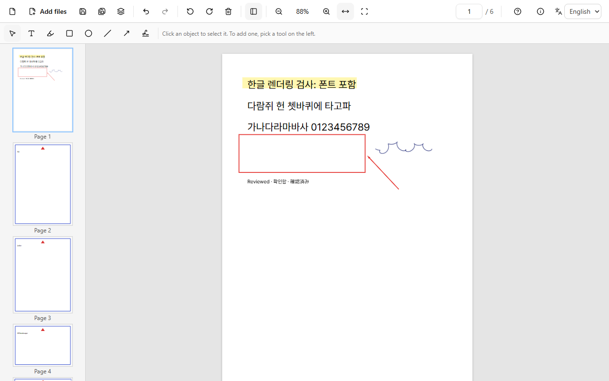

# HumblePDF

A humble little PDF tool: merge, sign, mark up. Fully offline.

HumblePDF is an offline PDF editor for Windows 11. It merges PDFs and images into one document,
organizes pages, and adds highlights, shapes, text and signature images. Edits are
non-destructive: source files are never modified, and saving always writes a new PDF.

The UI is available in English, Korean and Japanese. It follows the Windows display language
and can be changed from the toolbar.



## Download and run

1. Download `HumblePDF.exe` from the [Releases](../../releases) page. It is a single portable
   file: no installer, nothing else to download (Windows 11 already includes WebView2).
2. Run it. Windows may show **"Windows protected your PC"** (SmartScreen) because the exe is not
   code-signed. Click **More info → Run anyway** if you trust the download. Each release lists
   the SHA-256 hash of the exe so you can check it.

HumblePDF never connects to the internet. It keeps only small settings files in your user
profile:

- `%APPDATA%\io.github.dschoi1228.humblepdf\signatures\` — your signature images
- `%APPDATA%\io.github.dschoi1228.humblepdf\` and `%LOCALAPPDATA%\io.github.dschoi1228.humblepdf\`
  — window size, recent tool settings and the UI language

Delete those folders to remove everything the app has stored.

## Features

- Add PDFs (including password-protected ones) and JPG/PNG images, merged into one document.
  You can also choose HumblePDF in **Open with** or make it the default app for PDFs
- Continuous scrolling viewer with thumbnails and zoom from 25% to 400%
- Reorder pages by dragging thumbnails, select multiple pages, delete and rotate them, and
  choose how image pages fit (A4 or image size)
- Export only the selected pages to a new PDF
- Highlights, rectangles, ellipses, lines and arrows, saved as standard PDF annotations that
  other viewers can move or delete
- Text in Korean, English and Japanese, saved as FreeText annotations with embedded font
  subsets
- A signature library (PNG/JPG) and signature placement; signatures are baked into the page.
  Remove the white background of a photographed signature (with a strength slider), or draw
  a signature in black or blue
- Copy, paste and duplicate objects; undo and redo for everything
- Reopen a file saved by HumblePDF: its highlights, shapes and text come back editable
- Export a flattened copy with every object baked into the pages
- Print the document or the selected pages (**Ctrl+P**) through the built-in Edge PDF
  viewer, so text prints sharp
- Press **F1** in the app for all keyboard shortcuts

## Tech stack

| Area | Choice |
|---|---|
| App shell | [Tauri 2](https://tauri.app/) (WebView2) |
| UI | React, TypeScript, Vite, Tailwind CSS, shadcn/ui |
| Page rendering | [PDF.js](https://mozilla.github.io/pdf.js/) |
| Core | Rust: `lopdf` (PDF read/write), `subsetter` (font subsetting), `image` |
| Bundled fonts | Pretendard Regular and Pretendard JP (common characters), OFL 1.1 |

PDF bytes are produced only in the Rust core (`crates/core`). The frontend renders pages and
handles the editing UI. The document model's source of truth is a set of Rust types; the
TypeScript types are generated from them.

## Building

Requirements: Windows 11, Node.js 24, the Rust toolchain (stable), and Microsoft Edge (for
end-to-end tests).

```
npm install
npm run tauri dev        # run the app (development build)
npm run build:exe        # portable exe at target/release/HumblePDF.exe
```

If PowerShell's execution policy blocks `npm.ps1`, use `npm.cmd` instead of `npm`.
Regenerating the Japanese font subset (`npm run fonts`) also needs Python with fontTools; the
app and the build use the committed font files.

## Testing

```
cargo test --workspace                                 # core and CLI, including re-parsing exported PDFs
npm test                                               # frontend unit tests (Vitest)
npm run e2e                                            # end-to-end tests (Playwright, installed Edge)
cargo clippy --workspace --all-targets -- -D warnings
cargo fmt --all --check
npm run lint                                           # ESLint and TypeScript
```

All test files are synthetic. Run `npm run fixtures` to regenerate them. GitHub Actions runs
all of the above on every push and pull request.

## Repository layout

```
crates/core/    Rust library: document model, source inspection, PDF export, reopening
crates/cli/     Command-line front end to the core, for headless checks
src-tauri/      Tauri commands (thin wrappers around the core), signature library
src/            Frontend: viewer, editor overlay, state, UI
src/i18n/       UI strings (ko, en, ja)
assets/fonts/   Bundled fonts (and the source of the Japanese subset)
tests/          Fixtures, unit tests and end-to-end tests
docs/           Specification, decision log and milestone reports (Korean)
```

## Contributing translations

UI strings live in `src/i18n/`. `ko.ts` defines the keys, and `en.ts` and `ja.ts` must have
exactly the same keys; the type checker and `src/i18n/i18n.test.ts` enforce this. The Japanese
translation has not yet been reviewed by a native speaker, and corrections are welcome.

## License

HumblePDF is released under the [MIT License](LICENSE). It includes third-party components under
their own licenses (MIT, Apache-2.0, BSD, ISC, Unicode, Zlib, OFL 1.1 for the fonts, and MPL-2.0
for a few unmodified crates that Tauri uses); see [THIRD_PARTY_NOTICES.md](THIRD_PARTY_NOTICES.md).
